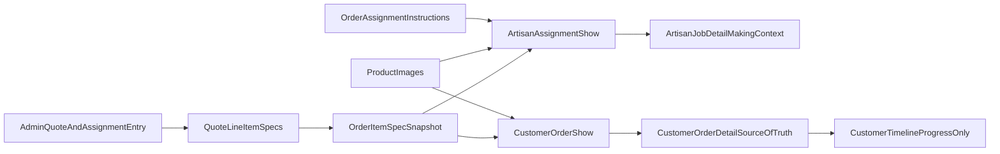

# Artisan Making Context + Three-Way Sync Plan

## Goal
Create a single source of truth for making data so:
- Admin enters technical specs + instructions once.
- Artisan job view shows complete specs, design photos, and notes.
- Customer Order Detail shows the exact same specs/photos for transparency.

## Current State (from code)
- Artisan detail currently only shows assignment status + order status + action buttons in [`/Users/pyitheimkyaw/UOG/Project/Shwe-Eain-Jewelry-Hub/frontend/lib/features/artisan/ui/artisan_job_detail_screen.dart`](/Users/pyitheimkyaw/UOG/Project/Shwe-Eain-Jewelry-Hub/frontend/lib/features/artisan/ui/artisan_job_detail_screen.dart).
- Assignment API already returns assignment + order + order items in [`/Users/pyitheimkyaw/UOG/Project/Shwe-Eain-Jewelry-Hub/backend/app/Http/Controllers/Api/V1/Artisan/AssignmentController.php`](/Users/pyitheimkyaw/UOG/Project/Shwe-Eain-Jewelry-Hub/backend/app/Http/Controllers/Api/V1/Artisan/AssignmentController.php).
- Admin already enters assignment instructions in Filament action form in [`/Users/pyitheimkyaw/UOG/Project/Shwe-Eain-Jewelry-Hub/backend/app/Filament/Resources/Orders/Pages/ViewOrder.php`](/Users/pyitheimkyaw/UOG/Project/Shwe-Eain-Jewelry-Hub/backend/app/Filament/Resources/Orders/Pages/ViewOrder.php).
- Quote creation already captures weight + gem/labor and optional product reference in [`/Users/pyitheimkyaw/UOG/Project/Shwe-Eain-Jewelry-Hub/backend/app/Filament/Resources/Inquiries/Pages/ChatInquiry.php`](/Users/pyitheimkyaw/UOG/Project/Shwe-Eain-Jewelry-Hub/backend/app/Filament/Resources/Inquiries/Pages/ChatInquiry.php) and [`/Users/pyitheimkyaw/UOG/Project/Shwe-Eain-Jewelry-Hub/backend/app/Services/QuoteBuilderService.php`](/Users/pyitheimkyaw/UOG/Project/Shwe-Eain-Jewelry-Hub/backend/app/Services/QuoteBuilderService.php).
- Customer currently has Orders list + Timeline, but no full Order Detail source-of-truth page in [`/Users/pyitheimkyaw/UOG/Project/Shwe-Eain-Jewelry-Hub/frontend/lib/features/orders/ui/customer_orders_screen.dart`](/Users/pyitheimkyaw/UOG/Project/Shwe-Eain-Jewelry-Hub/frontend/lib/features/orders/ui/customer_orders_screen.dart).

## Implementation Plan

## 1) Add structured making-spec fields at quote line + order item snapshot layer
- Add DB fields via migration(s):
  - `quote_line_items.metal_type` (nullable string)
  - `quote_line_items.stone_details` (nullable text)
  - `order_items.metal_type_snapshot` (nullable string)
  - `order_items.stone_details_snapshot` (nullable text)
- Update models fillable/casts:
  - [`/Users/pyitheimkyaw/UOG/Project/Shwe-Eain-Jewelry-Hub/backend/app/Models/QuoteLineItem.php`](/Users/pyitheimkyaw/UOG/Project/Shwe-Eain-Jewelry-Hub/backend/app/Models/QuoteLineItem.php)
  - [`/Users/pyitheimkyaw/UOG/Project/Shwe-Eain-Jewelry-Hub/backend/app/Models/OrderItem.php`](/Users/pyitheimkyaw/UOG/Project/Shwe-Eain-Jewelry-Hub/backend/app/Models/OrderItem.php)
- Thread these fields through quote creation and order creation snapshots:
  - [`/Users/pyitheimkyaw/UOG/Project/Shwe-Eain-Jewelry-Hub/backend/app/Services/QuoteBuilderService.php`](/Users/pyitheimkyaw/UOG/Project/Shwe-Eain-Jewelry-Hub/backend/app/Services/QuoteBuilderService.php)
  - [`/Users/pyitheimkyaw/UOG/Project/Shwe-Eain-Jewelry-Hub/backend/app/Services/OrderBuilderService.php`](/Users/pyitheimkyaw/UOG/Project/Shwe-Eain-Jewelry-Hub/backend/app/Services/OrderBuilderService.php)

## 2) Admin-side entry and persistence confirmation
- Extend quote publish form (Filament chat) to capture structured specs per line:
  - add `metal_type` and `stone_details` inputs in [`/Users/pyitheimkyaw/UOG/Project/Shwe-Eain-Jewelry-Hub/backend/app/Filament/Resources/Inquiries/Pages/ChatInquiry.php`](/Users/pyitheimkyaw/UOG/Project/Shwe-Eain-Jewelry-Hub/backend/app/Filament/Resources/Inquiries/Pages/ChatInquiry.php) + related Blade form bindings if needed.
- Keep assignment “special instructions” as-is but make it explicit and required when appropriate:
  - [`/Users/pyitheimkyaw/UOG/Project/Shwe-Eain-Jewelry-Hub/backend/app/Filament/Resources/Orders/Pages/ViewOrder.php`](/Users/pyitheimkyaw/UOG/Project/Shwe-Eain-Jewelry-Hub/backend/app/Filament/Resources/Orders/Pages/ViewOrder.php)
- Verify save path:
  - Quote line specs -> order item snapshots -> API responses.
  - Assignment instructions -> assignment API `show` payload.

## 3) Include design photos in assignment payload for artisan
- Expand artisan assignment eager loading to include product images:
  - `order.items.product.images`
  - `orderItem.product.images`
- Update endpoint in [`/Users/pyitheimkyaw/UOG/Project/Shwe-Eain-Jewelry-Hub/backend/app/Http/Controllers/Api/V1/Artisan/AssignmentController.php`](/Users/pyitheimkyaw/UOG/Project/Shwe-Eain-Jewelry-Hub/backend/app/Http/Controllers/Api/V1/Artisan/AssignmentController.php)
- Ensure customer order detail endpoint also includes matching product image relations:
  - [`/Users/pyitheimkyaw/UOG/Project/Shwe-Eain-Jewelry-Hub/backend/app/Http/Controllers/Api/V1/CustomerOrderController.php`](/Users/pyitheimkyaw/UOG/Project/Shwe-Eain-Jewelry-Hub/backend/app/Http/Controllers/Api/V1/CustomerOrderController.php)

## 4) Artisan Work View: complete making context
- Upgrade [`/Users/pyitheimkyaw/UOG/Project/Shwe-Eain-Jewelry-Hub/frontend/lib/features/artisan/ui/artisan_job_detail_screen.dart`](/Users/pyitheimkyaw/UOG/Project/Shwe-Eain-Jewelry-Hub/frontend/lib/features/artisan/ui/artisan_job_detail_screen.dart) with:
  - “Making Specs” section (item type/title, weight, metal type, stone details, MMK spec values if needed)
  - “Design Photos” gallery from product/order references
  - “Admin Instructions” section from assignment `instructions`
- Show line-item-scoped view when `task_scope == line_item`; otherwise show full-order spec set.

## 5) Customer Transparency: new Order Detail screen (primary)
- Add `CustomerOrderDetailScreen` and route from order card:
  - Show same source-of-truth fields as artisan view (specs + photos + instructions context where customer-safe).
- Files:
  - new: [`/Users/pyitheimkyaw/UOG/Project/Shwe-Eain-Jewelry-Hub/frontend/lib/features/orders/ui/customer_order_detail_screen.dart`](/Users/pyitheimkyaw/UOG/Project/Shwe-Eain-Jewelry-Hub/frontend/lib/features/orders/ui/customer_order_detail_screen.dart)
  - update navigation in [`/Users/pyitheimkyaw/UOG/Project/Shwe-Eain-Jewelry-Hub/frontend/lib/features/orders/ui/customer_orders_screen.dart`](/Users/pyitheimkyaw/UOG/Project/Shwe-Eain-Jewelry-Hub/frontend/lib/features/orders/ui/customer_orders_screen.dart)
- Keep Timeline as progress/milestone view and link to Detail as canonical spec/photo source.

## 6) Three-way sync guarantees (data contract)
- Define one canonical mapping:
  - Admin input fields -> DB snapshot fields -> Artisan UI fields -> Customer UI fields.
- Add backend response tests to assert both artisan and customer endpoints expose same snapshot values.
- Add widget/API parsing updates to ensure identical labels/formatting for specs across both apps.

## 7) Validation + documentation
- Backend:
  - migration + feature tests for spec field persistence and response parity.
  - run: `InquiryQuoteFlowTest`, `BespokeOrderWorkflowTest`, plus new tests for assignment/customer order payload parity.
- Frontend:
  - `flutter analyze` on modified artisan/order files.
  - manual QA matrix:
    - Admin enters specs/photos/instructions
    - Artisan sees full making context before starting
    - Customer Order Detail displays matching specs/photos
- Documentation updates:
  - [`/Users/pyitheimkyaw/UOG/Project/Shwe-Eain-Jewelry-Hub/docs/FYP_Technical_Log.md`](/Users/pyitheimkyaw/UOG/Project/Shwe-Eain-Jewelry-Hub/docs/FYP_Technical_Log.md)
  - [`/Users/pyitheimkyaw/UOG/Project/Shwe-Eain-Jewelry-Hub/docs/Local_Setup.md`](/Users/pyitheimkyaw/UOG/Project/Shwe-Eain-Jewelry-Hub/docs/Local_Setup.md)
  - include the three-way sync data contract and demo validation checklist.
