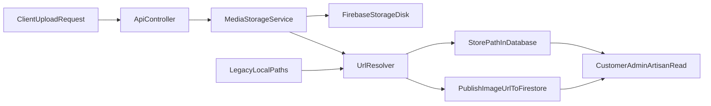

# Firebase Storage Media Migration Plan

## Goal
Move all new media uploads (chat images, inquiry attachments, artisan progress photos, deposit proofs) to Firebase Storage using Laravel Filesystem, without breaking current Customer/Admin chat behavior or existing local media reads.

## Scope and Decisions
- Storage approach: Laravel Filesystem with a GCS/Firebase Storage disk.
- Existing local data: no backfill now; keep dual-read compatibility so old local records still render.
- Preserve Firestore message contract (`type: image`, `image_url` absolute URL).

## Implementation Steps
- Add Firebase/GCS filesystem disk + env wiring in [backend/config/filesystems.php](/Users/pyitheimkyaw/UOG/Project/Shwe-Eain-Jewelry-Hub/backend/config/filesystems.php) and [backend/config/services.php](/Users/pyitheimkyaw/UOG/Project/Shwe-Eain-Jewelry-Hub/backend/config/services.php).
- Introduce a centralized media abstraction service (e.g., `MediaStorageService`) under [backend/app/Services](/Users/pyitheimkyaw/UOG/Project/Shwe-Eain-Jewelry-Hub/backend/app/Services) to:
  - store uploads to configured provider (`firebase` for new writes)
  - resolve public URL for both `firebase` and legacy `public` paths.
- Switch write paths to the new service (no API shape changes):
  - [backend/app/Http/Controllers/Api/V1/UploadController.php](/Users/pyitheimkyaw/UOG/Project/Shwe-Eain-Jewelry-Hub/backend/app/Http/Controllers/Api/V1/UploadController.php)
  - [backend/app/Http/Controllers/Api/V1/InquiryController.php](/Users/pyitheimkyaw/UOG/Project/Shwe-Eain-Jewelry-Hub/backend/app/Http/Controllers/Api/V1/InquiryController.php)
  - [backend/app/Http/Controllers/Api/V1/OrderProgressController.php](/Users/pyitheimkyaw/UOG/Project/Shwe-Eain-Jewelry-Hub/backend/app/Http/Controllers/Api/V1/OrderProgressController.php)
  - [backend/app/Http/Controllers/Api/V1/CustomerOrderDepositController.php](/Users/pyitheimkyaw/UOG/Project/Shwe-Eain-Jewelry-Hub/backend/app/Http/Controllers/Api/V1/CustomerOrderDepositController.php)
- Update URL publishing in [backend/app/Services/FirebaseInquiryService.php](/Users/pyitheimkyaw/UOG/Project/Shwe-Eain-Jewelry-Hub/backend/app/Services/FirebaseInquiryService.php) to use the media service for image URLs instead of direct `Storage::disk('public')->url(...)` assumptions.
- Keep read compatibility in existing UI surfaces by ensuring URL resolution accepts both providers/old local paths:
  - [frontend/lib/core/storage/public_storage_url.dart](/Users/pyitheimkyaw/UOG/Project/Shwe-Eain-Jewelry-Hub/frontend/lib/core/storage/public_storage_url.dart)
  - [backend/resources/views/filament/resources/inquiries/chat-inquiry.blade.php](/Users/pyitheimkyaw/UOG/Project/Shwe-Eain-Jewelry-Hub/backend/resources/views/filament/resources/inquiries/chat-inquiry.blade.php)
  - [frontend/lib/features/inquiries/ui/inquiry_chat_screen.dart](/Users/pyitheimkyaw/UOG/Project/Shwe-Eain-Jewelry-Hub/frontend/lib/features/inquiries/ui/inquiry_chat_screen.dart)
  - [frontend/lib/features/artisan/ui/artisan_job_detail_screen.dart](/Users/pyitheimkyaw/UOG/Project/Shwe-Eain-Jewelry-Hub/frontend/lib/features/artisan/ui/artisan_job_detail_screen.dart)
  - [frontend/lib/features/orders/ui/customer_order_detail_screen.dart](/Users/pyitheimkyaw/UOG/Project/Shwe-Eain-Jewelry-Hub/frontend/lib/features/orders/ui/customer_order_detail_screen.dart)
- Validate end-to-end:
  - backend tests for inquiry/order workflow paths touching uploads
  - `php artisan view:cache` for Filament Blade
  - `flutter analyze` on modified inquiry/artisan/order files
  - manual check: Customer sends image, Admin sends image, both sides render; inquiry attachments and artisan progress photos still visible.

## Data Flow (Post-Migration)

## Risks and Safeguards
- Risk: mixed old/new paths break rendering.
  - Safeguard: centralized URL resolver with explicit fallback to local `/storage/...` behavior.
- Risk: chat regressions from payload changes.
  - Safeguard: do not change Firestore message schema, only URL source.
- Risk: env/config drift.
  - Safeguard: update setup docs with required Firebase/GCS env values and validation steps.