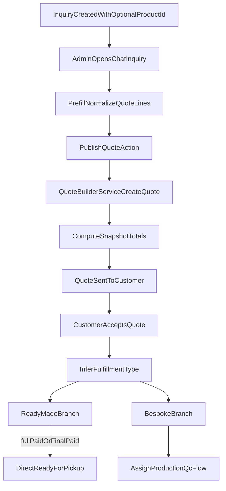

# Inquiry-to-Quote Product Prefill Plan

## Goal
Make inquiry-linked catalog products the default starting point for quote generation across both Filament concierge flow and admin API paths, with deterministic field precedence and no duplicate business logic.

## Current State (Confirmed)
- Inquiry stores linked product at [backend/app/Models/Inquiry.php] and `inquiries.product_id`.
- Quote publish currently accepts manual lines and optional `product_id` in [backend/app/Http/Controllers/Api/V1/Admin/InquiryQuotePublishController.php].
- Filament concierge quote UI starts with blank lines in [backend/app/Filament/Resources/Inquiries/Pages/ChatInquiry.php] and [backend/resources/views/filament/resources/inquiries/chat-inquiry.blade.php].
- Quote totals/snapshots are computed in [backend/app/Services/QuoteBuilderService.php], with product-linked labor/gem canonicalization already present.

## Design Decisions
- Keep one source of truth for quote computations in `QuoteBuilderService`.
- Add a shared normalization/prefill step before quote creation that can be reused by:
  - Filament publish-from-inquiry
  - API publish-from-inquiry
  - Admin quote creation with `inquiry_id`
- Default behavior: prefill only missing/blank fields (never overwrite explicit admin edits).
- Add explicit fulfillment branching for downstream order lifecycle:
  - `ready_made` orders can skip artisan/production stages.
  - `bespoke` orders continue with current assignment -> production -> QC flow.

## Ready-made Payment & Lifecycle Branch

### Business Policy
- **Ready-made default:** allow/encourage full payment settlement at quote acceptance/payment confirmation.
- **Optional deposit policy:** support deposit-first only when shop config requires reservation behavior.
- **Bespoke:** keep existing deposit-first + production lifecycle.

### Lifecycle Rules
- `ready_made + fully_paid` -> transition directly to `ready` (ready for pickup).
- `ready_made + deposit_confirmed` -> no artisan assignment; wait for remaining settlement, then `ready`.
- `ready_made` orders must skip:
  - assign artisan
  - in production
  - pending QC
- `bespoke` orders keep current lifecycle gates unchanged.

### Receipt Expectations
- `ready_made + full payment`:
  - issue final receipt with `payment_type = final`
  - `deposit_paid_mmk = 0`
  - `final_paid_mmk = order_total_mmk`
  - `is_fully_paid = true`
  - payment method label (`Cash` or profile name) preserved.
- `ready_made + deposit-first`:
  - keep deposit receipt + final receipt sequence.

## Field Precedence Contract
- `product_id`:
  - if line has `product_id`, keep it;
  - else if inquiry has linked product, inject inquiry `product_id`.
- `custom_title`:
  - keep explicit line value;
  - else default to product title.
- `weight_grams`:
  - keep explicit line value;
  - else default from product `weight_grams` if available;
  - else remain required for validation.
- `labor_fee_mmk`, `gem_price_mmk`:
  - keep visible prefill values for UX;
  - final calculation remains canonical from `product_id` inside `QuoteBuilderService` (existing rule).
- `metal_type`, `stone_details`:
  - keep explicit values;
  - otherwise optional defaults from product metadata where available.

## Implementation Steps
1. **Add reusable prefill/normalization helper**
   - Introduce helper logic in [backend/app/Services/QuoteBuilderService.php] (or a small dedicated service used by it) to hydrate line defaults from inquiry-linked product and per-line product.

2. **Wire API publish path**
   - In [backend/app/Http/Controllers/Api/V1/Admin/InquiryQuotePublishController.php], normalize incoming lines via shared helper before validation/create.

3. **Wire admin quote create path parity**
   - In [backend/app/Http/Controllers/Api/V1/Admin/QuoteController.php], when `inquiry_id` exists, run same normalization to avoid behavioral divergence.

4. **Upgrade Filament concierge UX**
   - In [backend/app/Filament/Resources/Inquiries/Pages/ChatInquiry.php]:
     - initialize first quote line from inquiry product when available,
     - add Livewire action `prefillFromInquiryProduct()`.
   - In [backend/resources/views/filament/resources/inquiries/chat-inquiry.blade.php]:
     - add a “Use linked product” button,
     - replace raw numeric `product_id` with searchable/select-friendly product picker UI (title + SKU).

5. **Maintain chat card/timeline consistency**
   - Ensure quote publish payload and existing Firebase sync/card rendering remain unchanged contract-wise in [backend/app/Services/FirebaseInquiryService.php] and chat views.

6. **Test coverage**
   - Extend/ add feature tests around:
     - inquiry with linked product + blank line => prefilled line created,
     - explicit manual fields are preserved,
     - calculations still canonical for product-linked labor/gem,
     - no linked product => current blank-slate behavior preserved.
   - Candidate files: [backend/tests/Feature/BespokeOrderWorkflowTest.php], plus a new focused prefill test file.

7. **Documentation updates**
   - Record behavior in:
     - [docs/FYP_Technical_Log.md]
     - [docs/ADMIN_SIDE_AUDIT.md]
     - [docs/Local_Setup.md] (smoke test steps for linked-product prefill).

8. **Ready-made lifecycle implementation**
   - Add/confirm order-level fulfillment inference (`ready_made` vs `bespoke`) at quote->order creation in [backend/app/Services/OrderBuilderService.php].
   - Update payment-confirmation lifecycle gate in [backend/app/Services/PaymentVerificationService.php] and [backend/app/Services/OrderLifecycleService.php] to allow direct `ready` transition for ready-made orders when settlement policy is met.
   - Ensure inquiry pipeline presentation in [backend/app/Services/InquiryPipelinePresenter.php] reflects direct ready-made closure path without fake production phases.
   - Keep push notifications consistent for final confirmation/completion.

9. **Ready-made regression tests**
   - Add coverage for:
     - ready-made full payment -> direct `ready` without assignment/QC
     - ready-made deposit then final -> direct `ready`
     - bespoke remains unchanged
     - receipt metadata correctness for full-paid ready-made path.
   - Candidate files: [backend/tests/Feature/FinalPaymentPickupWorkflowTest.php] plus new focused lifecycle test.

## Flow Diagram

## Validation Checklist
- Linked-product inquiry starts with populated quote line in Filament.
- Publish API works with missing `product_id` line fields when inquiry has product.
- Manual admin edits are not overwritten.
- Resulting quote/order snapshots and totals remain unchanged from current business rules.
- Existing non-linked inquiries still behave as blank-slate.
- Ready-made orders never require artisan assignment to reach pickup readiness.
- Full-paid ready-made orders issue final receipt with fully-paid metadata and correct payment-method label.