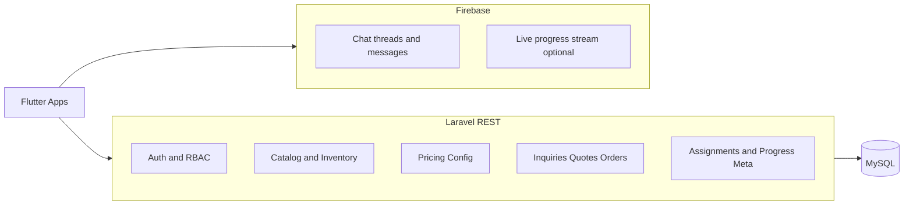

# Jewelry Hub: Database Schema (ERD) and API Plan

## Design principles

- **Weights**: Every persisted weight is `DECIMAL` in **grams** (`weight_grams`). Myanmar **Kyat/Pae/Yway** is derived in the app or API presentation layer using **16.606 g = 1 Kyat**, **16 Pae = 1 Kyat**, **8 Yway = 1 Pae** (no duplicate storage of Kyat-weight unless you add optional cached columns later).
- **Money**: Store monetary amounts in **USD** (`DECIMAL(12,4)` or `DECIMAL(14,2)` depending on precision needs). **MMK** for quotes/orders should store a **snapshot** of the exchange rate used (`exchange_rate_usd_to_mmk`, `total_mmk_at_quote`) so historical records stay correct when rates change.
- **Gold price**: Store **USD per gram** with **effective_from** (and optional **effective_to**) so you can audit price changes and compute totals at the time of quote/order.
- **Pricing formula** (persist inputs + outputs):  
`metal_usd = weight_grams * gold_price_usd_per_gram_at_time`  
`line_total_usd = metal_usd + labor_fee_usd + gem_price_usd`  
Then apply rate for display: `amount_mmk = amount_usd * rate_usd_to_mmk` (snapshot on quote/order).

## High-level architecture split




- **MySQL**: Source of truth for catalog, pricing configuration, inquiries, quotes, orders, assignments, and **metadata** for media (URLs/paths after upload).
- **Firebase** (per [.cursorrules](.cursorrules)): Real-time **chat** and optional **live** order progress; Laravel can still expose REST to **create** threads, **register** FCM tokens, and **finalize** progress entries into MySQL for reporting (recommended for FYP audit trail).

---

## Entity-relationship model (ERD)

```mermaid
erDiagram
  users ||--o| customer_profiles : has
  users ||--o| artisan_profiles : has
  users ||--o{ inquiries : creates
  users ||--o{ orders : places
  users ||--o{ order_assignments : assigned
  users ||--o{ order_progress_events : records

  categories ||--o{ products : contains
  products ||--o{ product_images : has
  products ||--o{ order_items : references

  gold_price_snapshots ||--o{ quote_line_items : priced_with
  exchange_rate_snapshots ||--o{ quotes : uses
  exchange_rate_snapshots ||--o{ orders : uses

  inquiries ||--o{ inquiry_attachments : has
  inquiries ||--o{ quotes : may_spawn

  quotes ||--o{ quote_line_items : contains
  quotes ||--o{ orders : converts_to

  orders ||--o{ order_items : contains
  orders ||--o{ order_assignments : has
  orders ||--o{ order_progress_events : has
  orders ||--o{ order_progress_attachments : has

  users {
    bigint id PK
    string email UK
    string password_hash
    enum role "admin artisan customer"
    string name
    timestamps
  }

  customer_profiles {
    bigint user_id PK_FK
    string phone
    string address_json "optional"
  }

  artisan_profiles {
    bigint user_id PK_FK
    string specialty "optional"
    boolean is_active
  }

  categories {
    bigint id PK
    string name
    string slug UK
    int sort_order
    timestamps
  }

  products {
    bigint id PK
    bigint category_id FK
    string sku UK
    string title
    text description
    decimal weight_grams
    decimal labor_fee_usd
    decimal gem_price_usd "nullable"
    boolean is_published
    boolean is_custom_order_template "optional flag"
    timestamps
  }

  product_images {
    bigint id PK
    bigint product_id FK
    string storage_path
    int sort_order
  }

  gold_price_snapshots {
    bigint id PK
    decimal price_usd_per_gram
    datetime effective_from
    datetime effective_to "nullable open-ended"
    bigint set_by_user_id FK "nullable"
    timestamps
  }

  exchange_rate_snapshots {
    bigint id PK
    decimal usd_to_mmk
    datetime effective_from
    datetime effective_to "nullable"
    bigint set_by_user_id FK "nullable"
    timestamps
  }

  inquiries {
    bigint id PK
    bigint customer_user_id FK
    text message
    enum status "open reviewing quoted closed"
    string firebase_thread_id "nullable sync key"
    timestamps
  }

  inquiry_attachments {
    bigint id PK
    bigint inquiry_id FK
    string storage_path
    string mime_type
    timestamps
  }

  quotes {
    bigint id PK
    bigint inquiry_id FK "nullable"
    bigint customer_user_id FK
    bigint gold_price_snapshot_id FK
    bigint exchange_rate_snapshot_id FK
    string quote_number UK
    enum status "draft sent accepted expired void"
    decimal total_usd
    decimal total_mmk_snapshot
    datetime valid_until "nullable"
    text notes_internal "admin only"
    timestamps
  }

  quote_line_items {
    bigint id PK
    bigint quote_id FK
    bigint product_id FK "nullable for fully custom lines"
    string custom_title "nullable"
    decimal weight_grams
    decimal gold_price_usd_per_gram "denormalized from snapshot"
    decimal metal_value_usd
    decimal labor_fee_usd
    decimal gem_price_usd
    decimal line_total_usd
    decimal line_total_mmk_snapshot
  }

  orders {
    bigint id PK
    bigint customer_user_id FK
    bigint quote_id FK "nullable"
    string order_number UK
    enum status "pending confirmed in_production qa ready shipped completed cancelled"
    decimal total_usd
    decimal total_mmk_snapshot
    bigint exchange_rate_snapshot_id FK "nullable if same as quote"
    text shipping_notes "nullable"
    timestamps
  }

  order_items {
    bigint id PK
    bigint order_id FK
    bigint product_id FK "nullable"
    string title_snapshot
    decimal weight_grams
    decimal metal_value_usd
    decimal labor_fee_usd
    decimal gem_price_usd
    decimal line_total_usd
  }

  order_assignments {
    bigint id PK
    bigint order_id FK
    bigint artisan_user_id FK
    enum task_scope "full_order line_item" "optional"
    bigint order_item_id FK "nullable"
    enum status "assigned in_progress blocked done"
    text instructions "nullable"
    timestamps
  }

  order_progress_events {
    bigint id PK
    bigint order_id FK
    bigint artisan_user_id FK
    enum stage "casting filing polishing setting qc other"
    text note "nullable"
    string firebase_event_id "nullable dedupe"
    timestamps
  }

  order_progress_attachments {
    bigint id PK
    bigint progress_event_id FK
    string storage_path
    string mime_type
  }
```


**Indexes (apply in migrations):** FK indexes on all `*_id` columns; composite `(effective_from, effective_to)` on pricing/rate tables; `(customer_user_id, created_at)` on inquiries/orders; `(artisan_user_id, status)` on assignments.

**Optional later (not required for MVP):** `audit_logs`, `notifications`, `wishlists`, `addresses` normalized, **GBP** columns if you re-align [.cursorrules](.cursorrules) with your latest currency scope.

---

## API endpoints (REST, Laravel)

Convention: prefix `**/api/v1`**, JSON, **Laravel Sanctum** bearer tokens. Responses include both **USD** and **MMK** where useful, with **snapshot** fields on quote/order resources.

### Auth and session


| Method | Endpoint         | Who    | Purpose                                                            |
| ------ | ---------------- | ------ | ------------------------------------------------------------------ |
| POST   | `/auth/register` | Public | Customer self-registration (admin/artisan creation via admin only) |
| POST   | `/auth/login`    | Public | Issue token                                                        |
| POST   | `/auth/logout`   | Auth   | Revoke current token                                               |
| GET    | `/auth/me`       | Auth   | Profile + role                                                     |


### Users and RBAC (admin)


| Method | Endpoint            | Who   | Purpose                             |
| ------ | ------------------- | ----- | ----------------------------------- |
| GET    | `/admin/users`      | Admin | Paginated users, filter by role     |
| POST   | `/admin/users`      | Admin | Create artisan/admin accounts       |
| PATCH  | `/admin/users/{id}` | Admin | Update user (e.g. activate artisan) |


### Catalog and inventory (admin + customer read)


| Method | Endpoint                      | Who            | Purpose                                             |
| ------ | ----------------------------- | -------------- | --------------------------------------------------- |
| GET    | `/catalog/categories`         | Public or Auth | List categories                                     |
| GET    | `/catalog/products`           | Public or Auth | List published products (filters: category, search) |
| GET    | `/catalog/products/{id}`      | Public or Auth | Product detail + images                             |
| POST   | `/admin/categories`           | Admin          | Create                                              |
| PATCH  | `/admin/categories/{id}`      | Admin          | Update                                              |
| DELETE | `/admin/categories/{id}`      | Admin          | Soft-delete optional                                |
| POST   | `/admin/products`             | Admin          | Create product (weight in grams, fees in USD)       |
| PATCH  | `/admin/products/{id}`        | Admin          | Update                                              |
| DELETE | `/admin/products/{id}`        | Admin          | Soft-delete / unpublish                             |
| POST   | `/admin/products/{id}/images` | Admin          | Upload image (multipart or presigned flow)          |
| DELETE | `/admin/product-images/{id}`  | Admin          | Remove image                                        |


### Pricing configuration (admin) and public “current” reads


| Method | Endpoint                | Who            | Purpose                                                          |
| ------ | ----------------------- | -------------- | ---------------------------------------------------------------- |
| GET    | `/pricing/gold/current` | Auth or Public | Current effective USD/gram (server picks active snapshot)        |
| GET    | `/pricing/gold/history` | Admin          | Audit list                                                       |
| POST   | `/pricing/gold`         | Admin          | New gold price snapshot (`price_usd_per_gram`, `effective_from`) |
| GET    | `/pricing/fx/current`   | Auth or Public | Current USD→MMK                                                  |
| GET    | `/pricing/fx/history`   | Admin          | Audit list                                                       |
| POST   | `/pricing/fx`           | Admin          | New rate snapshot                                                |


### Inquiries (customer + admin)


| Method | Endpoint                | Who      | Purpose                                                         |
| ------ | ----------------------- | -------- | --------------------------------------------------------------- |
| POST   | `/inquiries`            | Customer | Create inquiry + attach photos (multipart or staged upload IDs) |
| GET    | `/inquiries/mine`       | Customer | List own inquiries                                              |
| GET    | `/inquiries/{id}`       | Customer | Detail (ownership check)                                        |
| GET    | `/admin/inquiries`      | Admin    | List/filter by status                                           |
| GET    | `/admin/inquiries/{id}` | Admin    | Detail                                                          |
| PATCH  | `/admin/inquiries/{id}` | Admin    | Status, internal notes                                          |


### Quote Card (quotes)


| Method | Endpoint             | Who      | Purpose                                                                                                                                      |
| ------ | -------------------- | -------- | -------------------------------------------------------------------------------------------------------------------------------------------- |
| POST   | `/admin/quotes`      | Admin    | Create quote from inquiry or ad-hoc; body includes line items (weights, fees); server resolves current gold + FX snapshots and stores totals |
| GET    | `/admin/quotes`      | Admin    | List                                                                                                                                         |
| GET    | `/admin/quotes/{id}` | Admin    | Detail with line items                                                                                                                       |
| PATCH  | `/admin/quotes/{id}` | Admin    | Update status (send/accept/void)                                                                                                             |
| GET    | `/quotes/mine`       | Customer | Customer-facing quote list                                                                                                                   |
| GET    | `/quotes/{id}`       | Customer | **Quote Card** payload (PDF generation can be server-side later)                                                                             |


**Firebase bridge (minimal REST):**


| Method | Endpoint                                        | Who            | Purpose                                                                                       |
| ------ | ----------------------------------------------- | -------------- | --------------------------------------------------------------------------------------------- |
| POST   | `/conversations/{inquiryId}/firebase-bootstrap` | Customer/Admin | Returns or creates `firebase_thread_id`, rules-friendly claims hint (implementation-specific) |


*(Exact shape depends on your Firebase security rules; keep thread IDs in `inquiries` as in ERD.)*

### Orders (customer + admin)


| Method | Endpoint             | Who      | Purpose                                          |
| ------ | -------------------- | -------- | ------------------------------------------------ |
| POST   | `/admin/orders`      | Admin    | Create from accepted quote (copies snapshots)    |
| GET    | `/admin/orders`      | Admin    | List/filter                                      |
| GET    | `/admin/orders/{id}` | Admin    | Detail + items + assignments + progress timeline |
| PATCH  | `/admin/orders/{id}` | Admin    | Status, shipping notes                           |
| GET    | `/orders/mine`       | Customer | List                                             |
| GET    | `/orders/{id}`       | Customer | Detail + progress summary                        |


### Artisan: assignments and progress


| Method | Endpoint                             | Who                             | Purpose                                                            |
| ------ | ------------------------------------ | ------------------------------- | ------------------------------------------------------------------ |
| GET    | `/artisan/assignments`               | Artisan                         | List assigned tasks                                                |
| GET    | `/artisan/assignments/{id}`          | Artisan                         | Task detail with order context                                     |
| PATCH  | `/artisan/assignments/{id}`          | Artisan                         | Status updates (in_progress, blocked, done)                        |
| POST   | `/artisan/orders/{orderId}/progress` | Artisan                         | Create progress event (stage, note, photos) — persists to MySQL    |
| GET    | `/orders/{orderId}/progress`         | Customer/Admin/Assigned artisan | Ordered timeline (from DB; Flutter may also subscribe to Firebase) |


### Admin dashboard aggregates (optional but FYP-friendly)


| Method | Endpoint                   | Who   | Purpose                                                             |
| ------ | -------------------------- | ----- | ------------------------------------------------------------------- |
| GET    | `/admin/dashboard/summary` | Admin | Counts: open inquiries, orders in production, low-stock placeholder |
| GET    | `/admin/reports/orders`    | Admin | Date-range export                                                   |


### Media uploads


| Method | Endpoint           | Who  | Purpose                                     |
| ------ | ------------------ | ---- | ------------------------------------------- |
| POST   | `/uploads/presign` | Auth | Optional S3/minio presigned URL pattern     |
| POST   | `/uploads`         | Auth | Direct multipart if using local/public disk |


---

## Validation and authorization rules (implementation notes)

- **Customers** can only access `mine` resources and `orders/{id}` / `quotes/{id}` they own.
- **Artisans** can only access assignments where `artisan_user_id = auth.id` and related order read-only fields.
- **Admins** bypass ownership for management routes under `/admin/`*.
- **Quote/order immutability**: After `accepted` / `confirmed`, restrict edits to status and operational fields; financial snapshots remain fixed.

---

## Deliverables after plan approval (for your next step)

1. Laravel migrations matching the ERD (database-first per rules).
2. Form Requests + Policies for the endpoint matrix above.
3. Log the schema and API version in `[docs/FYP_Technical_Log.md](docs/FYP_Technical_Log.md)` when you implement.

