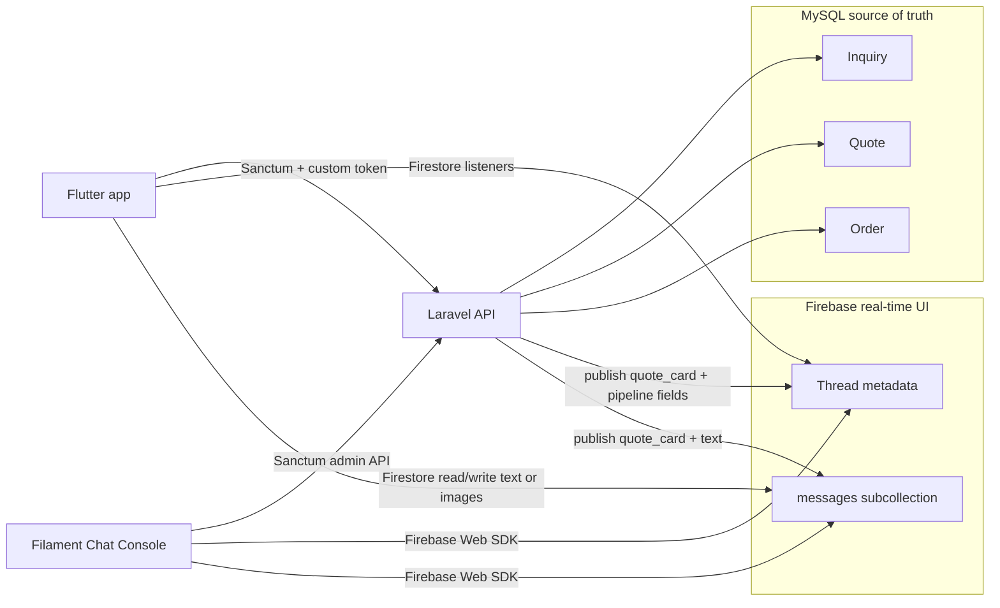

# Luxury Concierge Inquiry & Consultation Overhaul

## Current foundation (what we keep)

- **MySQL as truth**: [`Inquiry`](backend/app/Models/Inquiry.php), [`Quote`](backend/app/Models/Quote.php), [`Order`](backend/app/Models/Order.php) already model the business lifecycle; [`QuoteBuilderService`](backend/app/Services/QuoteBuilderService.php) freezes **gold + FX snapshots** on lines; [`OrderBuilderService`](backend/app/Services/OrderBuilderService.php) copies line snapshots into **order items** when built from an **accepted** quote.
- **Admin quote API**: [`Admin\QuoteController::store`](backend/app/Http/Controllers/Api/V1/Admin/QuoteController.php) already accepts `inquiry_id` and sets inquiry `status` to `quoted`.
- **Gap to close**: There is **no customer API** to **accept** a quote and **create an order** in one trusted transaction; [`OrderController::store`](backend/app/Http/Controllers/Api/V1/Admin/OrderController.php) is admin-only. Quotes are created as **`draft`** in [`QuoteBuilderService`](backend/app/Services/QuoteBuilderService.php)—you will want an explicit **“publish to customer”** transition (e.g. `draft` → `sent`) when the quote appears in chat.
- **Firebase today**: [`firebase/firestore.rules`](firebase/firestore.rules) allow only **`text` + `sender_role`** messages; [`FirebaseInquiryService`](backend/app/Services/FirebaseInquiryService.php) can upsert **thread metadata** but does not yet write **chat messages** server-side.

## Target architecture

**Principle**: Every **business mutation** (quote created, quote sent, quote accepted, order created, inquiry/order status changes) **commits in MySQL first**, then **mirrors** to Firestore for **latency and UX** (message list, quote card, stepper). If Firestore write fails, the API should still succeed and optionally **retry/log** (same pattern as today’s non-fatal `syncInquiryThreadDocument`).

---

## 1. Domain & API design (Laravel)

**1.1 Pipeline model (avoid duplicating state)**

- **Option A (recommended)**: **Derive** the customer-facing stepper from existing rows: `inquiry.status`, latest **`sent`** quote for that inquiry, and linked **`order.status`**. No migration if the mapping is unambiguous.
- **Option B**: Add `inquiries.pipeline_stage` or extend the `inquiries.status` enum (e.g. include `in_production`, `ready_for_pickup`) **only** if product needs explicit steps that do not map cleanly to `orders.status`.

**Suggested mapping for the four UX steps** (adjust labels in UI only):

| Step | Rule of thumb |
|------|----------------|
| Consulting | Inquiry `open` or `reviewing`; no `sent` quote yet |
| Quoted | At least one quote with `sent` (or `accepted` if you skip `sent`) for this inquiry |
| In production | Order exists and `order.status` in `pending`, `confirmed`, `in_production`, `qa` |
| Ready | Order exists and `order.status` in `ready`, `shipped`, `completed` |

Expose a small **serializer** (e.g. `InquiryPipelinePresenter`) used by **GET inquiry** and optionally **GET admin/inquiries/{id}** so Flutter and Filament share one definition.

**1.2 Customer: accept quote and create order**

- Add **`POST /api/v1/quotes/{quote}/accept`** (or under `inquiries/{inquiry}`) authenticated as **customer**, authorized via `QuotePolicy`:
  - Preconditions: quote belongs to user, `inquiry_id` matches if present, quote status `sent`, not expired.
  - Transaction: set quote `accepted` → call existing [`OrderBuilderService::createFromQuote`](backend/app/Services/OrderBuilderService.php) → update **inquiry** status (e.g. stay `quoted` or move to a closed/active state per product rules).
- Optional: **`POST .../decline`** setting quote `void` and inquiry back to `reviewing` for another round.

**1.3 Admin: “Generate quote from chat”**

- Add **`POST /api/v1/admin/inquiries/{inquiry}/quotes/publish`** (name TBD) that:
  - Validates line payload (reuse [`Admin\QuoteController::store`](backend/app/Http/Controllers/Api/V1/Admin/QuoteController.php) rules or delegate to `QuoteBuilderService`).
  - Creates quote, sets status **`sent`** (not `draft`), sets inquiry to `quoted`.
  - **Publishes** a **quote card** to Firestore (see section 2).

**1.4 Quote lifecycle clarity**

- Today `createQuote` sets **`draft`**. For concierge UX, either:
  - **Split**: internal draft vs **publish** endpoint that flips to `sent` and triggers Firestore, or
  - **Single admin action** from Filament that creates **already `sent`** when posting to the customer.

---

## 2. Firebase: messages, quote cards, and thread metadata

**2.1 Message schema (versioned)**

- Introduce **`type`**: `text` | `quote_card` | `image` (and optionally `system`).
- **Common fields**: `created_at`, `sender_role`, `laravel_user_id` (where applicable).
- **`quote_card`**: include **`quote_id`**, **denormalized** MMK breakdown (totals + line summaries) for instant render; clients **re-fetch** quote from API if they need full detail or tamper detection.
- **`image`**: store **HTTPS URL** to existing public/MinIO attachments (align with current upload flow) or Firebase Storage later—**update** [`firebase/firestore.rules`](firebase/firestore.rules) to allow the new shapes and size limits.

**2.2 Who writes what**

- **Customers / admins**: continue to write **`text`** (and **`image`** if rules allow) from the client.
- **Quote cards**: **only Laravel** (Admin SDK) writes `quote_card` documents **after** MySQL commit—prevents forged totals and keeps integrity.

**2.3 Thread document**

- Extend [`FirebaseInquiryService::syncInquiryThreadDocument`](backend/app/Services/FirebaseInquiryService.php) (or a dedicated method) to set fields the app can **subscribe to in one listener**: e.g. `inquiry_status`, `pipeline_step`, `active_quote_id`, `order_id`, `order_status`, `updated_at`. Update these on every relevant API success (quote publish, accept, order status change from admin).

**2.4 Dependencies**

- Server-side Firestore writes require a working **Firestore client** (PHP `ext-grpc` / `google/cloud-firestore` as noted in the technical log). If unavailable in a dev environment, fall back to **client-only text** + **polling** `GET /inquiries/{id}` for pipeline—a documented degradation path.

---

## 3. Flutter: Messenger UX + design system

**3.1 Screen structure**

- Replace the current “static list” feel in [`inquiry_chat_screen.dart`](frontend/lib/features/inquiries/ui/inquiry_chat_screen.dart) with:
  - **Pinned header**: pipeline **stepper** (four steps) fed by **thread doc** listener with **fallback** from REST `GET inquiry`.
  - **Reverse list** (`ListView.builder` reverse or `CustomScrollView`) with **grouped timestamps**, **scroll-to-bottom** on new messages, **read** cursor optional later.
  - **Composer**: text field + attach photo (reuse existing upload + URL pattern); send writes Firestore doc matching new rules.

**3.2 Bubbles & motion**

- Strictly use [`design_system.dart`](frontend/lib/core/ui/design_system.dart), [`AppGlassCard`](frontend/lib/core/ui/widgets/app_glass_card.dart), [`PremiumText`](frontend/lib/core/ui/widgets/premium_text.dart): **customer** gold-leaning bubbles, **concierge/admin** glass/slate with gold border (per `.cursorrules`).
- **`quote_card` bubble**: dedicated widget showing **Gold / Labor / Gems / Total MMK** (and optional USD via existing pricing provider), **Accept** / **Decline** calling new REST endpoints; disable after action; show **order number** after success (from API response or follow-up inquiry load).

**3.3 Data flow**

- On open: obtain Firebase custom token ([existing flow](docs/FYP_Technical_Log.md)), subscribe to `inquiry_threads/{id}/messages` **orderBy created_at**, and to **thread doc** for stepper.
- Keep **MySQL** as validation for accept/decline—Firestore is display-only for amounts on the card.

---

## 4. Filament: unified Chat Console

**4.1 Layout**

- Evolve [`ChatInquiry`](backend/app/Filament/Resources/Inquiries/Pages/ChatInquiry.php) + [`chat-inquiry.blade.php`](backend/resources/views/filament/resources/inquiries/chat-inquiry.blade.php) into a **full-height console**: same **stepper** as Flutter, **message stream**, **composer**, and an **action rail** (“Generate quote”)—not a cramped subform.

**4.2 Generate Quote flow**

- **Modal or slide-over** with line items (weight, labor, gems, optional product link)—submits to **`admin/inquiries/{id}/quotes/publish`**.
- On success: refresh Filament message list (Firestore listener) and show confirmation; no duplicate quote rows in MySQL.

**4.3 Styling**

- Align Filament panel primary `#D4AF37` with **Dark Gold** surfaces (glass-like cards via Tailwind + backdrop blur where supported) so the console **feels** like the app, not a default table theme.

---

## 5. Live progress tracker (order phase)

- After order exists, the **same stepper** can show **In production** / **Ready** from **`orders.status`** (already in schema). Optionally subscribe to [`order_progress_events`](backend/app/Models/OrderProgressEvent.php) for **milestones** inside “In production”—either:
  - **REST polling** from Flutter order detail, or
  - Future: **mirror** key progress events to Firestore thread doc for one subscription.

---

## 6. Documentation & tests

- Append a dated section to [`docs/FYP_Technical_Log.md`](docs/FYP_Technical_Log.md): message schema, new endpoints, pipeline rules, deploy **Firestore rules** after changes.
- **Feature tests**: customer accept creates order; admin publish creates `sent` quote + optional Firestore write (mocked); policy tests for cross-user access.

---

## 7. What may be discarded or heavily rewritten

- **Flutter** [`inquiry_chat_screen.dart`](frontend/lib/features/inquiries/ui/inquiry_chat_screen.dart): likely **rewrite** layout and listeners for reverse list + new message types + stepper.
- **Filament** Blade chat: **substantial UI/JS** rework for Messenger layout and quote composer; domain logic stays in Laravel.
- **Firestore rules**: **must** change for non-text messages and possibly to **block** client-created `quote_card` (server-only).

---

## Suggested implementation order

1. **API + policies**: customer accept/decline; admin publish quote; pipeline presenter on inquiry JSON.
2. **Firestore**: rules + thread fields + Laravel writer for `quote_card` + metadata sync.
3. **Flutter**: stepper + message list + quote card widget + wire accept.
4. **Filament**: chat console UX + generate quote UI calling the new admin endpoint.
5. **Polish**: typing indicators (optional), image messages, order progress mirroring.

This sequence delivers the **“magic” quote moment** and **order conversion** early once the API and server-side Firestore publish path exist.
