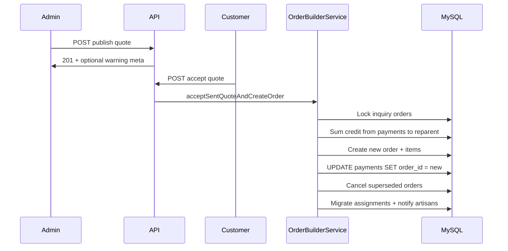

# Relaxed quote publishing, deposit credit, and artisan notice

## Current behavior (what changes)

- [`InquiryQuoteCommitmentGate`](backend/app/Services/InquiryQuoteCommitmentGate.php) **aborts** publish / admin quote-with-inquiry / `sent` promotion when order is past `awaiting_deposit` or deposit is `awaiting_verification` / `confirmed`.
- [`OrderBuilderService::supersedeAwaitingDepositOrdersForInquiry`](backend/app/Services/OrderBuilderService.php) only targets `awaiting_deposit` and **aborts** accept if deposit is `awaiting_verification` or `confirmed`.

You want the opposite for **publishing**: always allowed. For **accept**: always allowed (including while proof is awaiting verification), with **payment carry-over** (reparent rows, never delete confirmed payments) and **clear UX** for total vs credited vs amount still due.

## 1) Publish path: remove hard block, add warning

- **Service**: Refactor [`InquiryQuoteCommitmentGate`](backend/app/Services/InquiryQuoteCommitmentGate.php) into a non-blocking advisor, e.g. `warningForPublishing(Inquiry $inquiry): ?string`:
  - Return the exact admin copy when **any non-cancelled** order on the inquiry has a **confirmed** deposit payment: *"A deposit is already confirmed. A new quote will recalculate the balance."*
  - Optionally add a softer warning when order status is beyond `awaiting_deposit` but deposit state is ambiguous (can be same message or omitted—default: **only** confirmed deposit, per your spec).
- **Remove** `assertCanPublishSentQuoteToInquiry` / `assertCanPublishSentQuoteForQuoteModel` **abort** usage from:
  - [`InquiryQuotePublishController`](backend/app/Http/Controllers/Api/V1/Admin/InquiryQuotePublishController.php)
  - [`QuoteController`](backend/app/Http/Controllers/Api/V1/Admin/QuoteController.php) (`store` with `inquiry_id`, `update` → `sent`)
- **API response**: On successful publish (201), include e.g. `meta.warning` when non-null so non-Filament clients see it.
- **Filament**: [`ChatInquiry::publishQuoteFromConsole`](backend/app/Filament/Resources/Inquiries/Pages/ChatInquiry.php) + [`chat-inquiry.blade.php`](backend/resources/views/filament/resources/inquiries/chat-inquiry.blade.php): remove disabled “Generate quote” state tied to the gate; after successful publish, if warning present, `Notification::make()->warning()->title(...)->send()` (in addition to success).
- **Docs/rules**: Update [`.cursorrules`](.cursorrules) and [`docs/FYP_Technical_Log.md`](docs/FYP_Technical_Log.md) to describe warnings vs old 422 behavior.

## 2) Accept path: supersede all active orders + reparent payments

Extend [`OrderBuilderService`](backend/app/Services/OrderBuilderService.php) (single DB transaction, `lockForUpdate` on affected rows):

1. **Scope**: All `orders` linked to the inquiry via `quotes.inquiry_id` with `status != cancelled` (not only `awaiting_deposit`).
2. **Remove** the abort that blocks supersede when deposit is `awaiting_verification` or `confirmed`.
3. **Before** creating the new order, compute **`creditConfirmedMmk`** = sum of `payments.amount_mmk` where `type = deposit` and `status = confirmed` across those orders (and optionally treat `awaiting_verification` as **not** credited until confirmed—only **confirmed** reduces balance; proof still in flight remains on reparented row for admin to approve/reject on the new order).
4. **Create** new order + line items (same as today).
5. **Reparent payments**: `UPDATE payments SET order_id = :newOrderId WHERE order_id IN (:supersededIds) AND type = deposit` — **no delete** of confirmed rows. (Cascade on order delete is avoided because orders are cancelled, not deleted.)
6. **Cancel** superseded orders: set `status = cancelled`, clear `deposit_instructions_sent_at` as today where appropriate.
7. **Deposit due on new order**:
   - `requiredDepositMmk = round(total_mmk * default_deposit_percentage / 100, 4)` (same formula as [`insertOrderAndItemsFromQuote`](backend/app/Services/OrderBuilderService.php)).
   - `additionalDueMmk = max(0, requiredDepositMmk - creditConfirmedMmk)`.
   - Set `orders.deposit_amount_mmk = additionalDueMmk`.
   - If `additionalDueMmk == 0`, set new order `status = deposit_confirmed` (deposit requirement satisfied by credit). If `> 0`, `status = awaiting_deposit`.
   - **Edge**: If `creditConfirmedMmk >= total_mmk` (overpay): clamp behavior (e.g. `additionalDueMmk = 0`, status `deposit_confirmed`, optional note in logs)—document in code comment.

**Payment instructions / profile**: Existing [`OrderPaymentInstructionController`](backend/app/Http/Controllers/Api/V1/Admin/OrderPaymentInstructionController.php) and [`InquiryPipelinePresenter::depositPaymentDisplay`](backend/app/Services/InquiryPipelinePresenter.php) should continue to work; the **amount** shown on the card should reflect **what the customer must pay next** (`deposit_amount_mmk`), not the full % of the new total when credit applies.

## 3) Pipeline + Firestore + Flutter: show Total, credited, remaining

- **Presenter** [`InquiryPipelinePresenter::depositPaymentDisplay`](backend/app/Services/InquiryPipelinePresenter.php) (and any mirror used for REST `meta.pipeline.deposit_payment`): add fields such as `order_total_mmk`, `credited_deposit_mmk`, `additional_deposit_due_mmk` (strings for JSON parity), while keeping `amount_mmk` as the **due now** for backward compatibility.
- **Firebase** [`FirebaseInquiryService::publishPaymentInfoCard`](backend/app/Services/FirebaseInquiryService.php) / thread sync: include the same optional fields when publishing/updating so chat cards stay consistent.
- **Flutter** [`InquiryPaymentInfoCard`](frontend/lib/features/inquiries/widgets/inquiry_payment_info_card.dart) + call sites in [`inquiry_chat_screen.dart`](frontend/lib/features/inquiries/ui/inquiry_chat_screen.dart): optional rows, e.g. “Order total”, “Already paid (recognized)”, “Pay now”, only when credited &gt; 0 or keys present.
- **Models** [`inquiry_pipeline.dart`](frontend/lib/features/inquiries/models/inquiry_pipeline.dart): parse new keys.

## 4) Assignments + artisan notification

- After creating the new order, **migrate** active assignments from superseded orders so artisans are not stranded on cancelled orders:
  - For `order_assignments` with `status IN ('assigned','in_progress')` on superseded orders: `UPDATE order_id = newOrderId`, set `order_item_id = null` (line-item scope cannot map 1:1 to new items without a mapping step).
  - Append short text to `instructions` (e.g. “Quote revised — review design changes.”).
- **Notify** distinct `artisan_user_id`s (from migrated or pre-migrate rows):
  - Publish Laravel’s standard `notifications` table migration if missing, then add a `Notification` class (database channel) e.g. `QuoteRevisedForArtisan` with payload: inquiry id, new `order_id`, new `order_number`, message text matching your UX.
  - **Optional follow-up** (if you want in-app): `GET /api/v1/artisan/notifications` + Flutter list—out of scope for minimal delivery unless you want it in the same PR; the plan default is **database notification + API endpoint** so the mobile app can poll later.

## 5) Tests

- **Replace** expectations in [`BespokeOrderWorkflowTest`](backend/tests/Feature/BespokeOrderWorkflowTest.php) and [`InquiryQuoteFlowTest`](backend/tests/Feature/InquiryQuoteFlowTest.php) that assert **422** on publish / patch-to-`sent` after commitment with:
  - Publish succeeds; optional `meta.warning` when deposit confirmed.
- **New** feature tests for accept-after-confirmed-deposit:
  - Old order cancelled; payments reparented; new order `deposit_amount_mmk` and `status` correct; sum of confirmed amounts preserved.
- **New** test: accept while deposit `awaiting_verification` — payment row reparented; new order status/deposit rules as designed (credit only from **confirmed** amounts).
- **Assignment migration** + **notification** recorded (assert `notifications` table row count / `artisan` id) when assignment existed.

## 6) Risk / product notes (explicit)

- Superseding an order in **`in_production` / `pending_qc`** is destructive to workflow continuity; you are choosing to allow it. The warning + artisan notice mitigate confusion; consider a **stronger** warning in Filament when `order.status` is not `awaiting_deposit` (optional enhancement).
