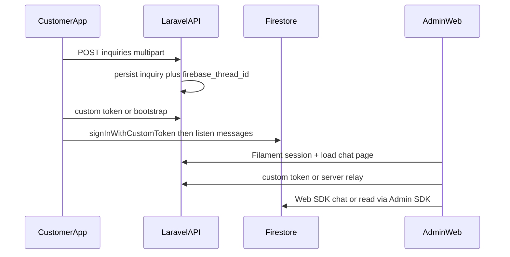

# Real-time Inquiry System (Flutter + Laravel + Filament + Firebase)

## Current baseline (already in repo)

- **Customer API** ([`backend/app/Http/Controllers/Api/V1/InquiryController.php`](backend/app/Http/Controllers/Api/V1/InquiryController.php)): `POST /api/v1/inquiries` (multipart: `message`, optional `attachments[]` images), `GET /api/v1/inquiries/mine` (paginated), `GET /api/v1/inquiries/{id}`.
- **Statuses** in DB ([`backend/database/migrations/2026_04_03_100070_create_inquiries_table.php`](backend/database/migrations/2026_04_03_100070_create_inquiries_table.php)): `open`, `reviewing`, `quoted`, `closed` — map in UI to labels such as **Pending** (open/reviewing), **Quoted**, **Closed**.
- **Firebase bridge** ([`backend/app/Http/Controllers/Api/V1/ConversationController.php`](backend/app/Http/Controllers/Api/V1/ConversationController.php)): `POST /api/v1/conversations/{inquiry}/firebase-bootstrap` generates `firebase_thread_id` **only if missing** — today **not** set on create (gap vs your story).
- **Policies** ([`backend/app/Policies/InquiryPolicy.php`](backend/app/Policies/InquiryPolicy.php)): customer sees own inquiries; admin sees all.
- **Filament**: **No** `InquiryResource` yet (only catalog/pricing resources under [`backend/app/Filament/Resources/`](backend/app/Filament/Resources/)); admin inquiries exist only via [`AdminInquiryController`](backend/app/Http/Controllers/Api/V1/Admin/InquiryController.php) JSON API.

---

## Architecture (target)

**Firestore data model (recommended):** collection `inquiry_threads/{threadId}/messages/{messageId}` with fields such as `text`, `senderUid` (or `senderRole` + `laravelUserId`), `createdAt` (server timestamp). `threadId` **equals** `inquiries.firebase_thread_id`.

**Security:** Flutter app uses **Laravel Sanctum**, not Firebase Auth by default. To make Firestore rules meaningful, plan a **Firebase custom token** endpoint (e.g. `POST /api/v1/auth/firebase-token` or `POST /api/v1/conversations/{inquiry}/firebase-token`) implemented with **Firebase Admin PHP** (`kreait/firebase-php` or similar), issuing a UID like `laravel_user_{id}` and optional custom claims (`role`, `thread_id`). Flutter calls `FirebaseAuth.instance.signInWithCustomToken` before opening the chat stream. **Firestore rules** must be written to allow only participants (customer + admin) for that thread — typically by storing a `threads/{threadId}` document with `customer_user_id` / `admin_uid` or validating claims.

**Admin Filament:** Session-based admin is not Firebase-authenticated; the same token endpoint can issue an admin-scoped custom token for the **web chat** page (Blade/Livewire + Firebase JS) **or** messages are posted via Laravel using the Admin SDK (server-side write) with polling for reads — **prefer** custom token + Firebase Web SDK for true real-time parity with Flutter.

---

## 1. Backend: align with story + support chat

| Task | Detail |
|------|--------|
| **Generate thread on create** | In [`InquiryController::store`](backend/app/Http/Controllers/Api/V1/InquiryController.php), set `firebase_thread_id` to `(string) Str::uuid()` when creating the inquiry (keep `firebase-bootstrap` idempotent for older rows). |
| **Optional `product_id`** | If “about a piece” should link to catalog: add nullable `product_id` FK migration + validation on `store` and expose in JSON. |
| **Firebase Admin + custom token** | Add Composer dependency; env vars (`FIREBASE_CREDENTIALS` path or JSON); new service + controller method to mint custom token for **customer** (must own inquiry) and **admin** (must be admin). |
| **Normalize list API (optional)** | Consider wrapping `GET inquiries/mine` in `{ data: ... }` for consistency with other endpoints — **or** parse Laravel’s default pagination shape in Flutter (`data` key). |

---

## 2. Flutter (customer): premium UI + session

**Dependencies:** `firebase_core`, `firebase_auth`, `cloud_firestore` (versions aligned with FlutterFire); reuse [`ApiConfig`](frontend/lib/core/config/api_config.dart) and [`AuthProvider.token`](frontend/lib/core/providers/auth_provider.dart) for authenticated HTTP.

| Flow | Implementation notes |
|------|------------------------|
| **Navigation shell** | Replace single `ProductCatalogScreen` home with a **bottom navigation** or drawer: **Catalog** \| **Inquiries** (and keep catalog/detail as today). All new screens use [`AppGlassCard`](frontend/lib/core/ui/widgets/app_glass_card.dart), [`AppGoldButton`](frontend/lib/core/ui/widgets/app_gold_button.dart), [`PremiumText`](frontend/lib/core/ui/widgets/premium_text.dart), [`AppGradients.backgroundMesh`](frontend/lib/core/ui/design_system.dart). |
| **New inquiry** | `POST` multipart: `message` + `files` from `image_picker` / `file_picker`; preview thumbnails; show API validation errors. After success, navigate to **chat** or inquiry detail and call bootstrap/token if needed. |
| **Inquiry list** | `GET /inquiries/mine` — list with `AppGlassCard` rows, **status badge** (mapped colors: pending vs quoted vs closed), relative time. |
| **Chat** | `Firebase.initializeApp` (from `dart-define` or config files); `signInWithCustomToken`; `Stream`/`snapshots` on `inquiry_threads/{threadId}/messages` ordered by `createdAt`; composer with send; show sender role (customer vs admin). |
| **Attachment URLs** | Build public URLs for attachment `storage_path` like catalog (base URL + `/storage` path). |

**Tests:** mock Firestore or use `fake_cloud_firestore` if feasible; at minimum widget tests for list/badge mapping and **document** manual Firebase test steps.

---

## 3. Filament: Inquiry management

- Add **`InquiryResource`** (list, view, edit status, internal notes) using existing patterns from [`ProductResource`](backend/app/Filament/Resources/Products/ProductResource.php).
- **Chat action:** Custom **Filament page** or **View** with a **“Open chat”** full-page route: Blade view with Firebase web SDK, obtains **custom token** via authenticated Laravel (same-origin fetch to new API route), subscribes to the same Firestore path as Flutter. Fallback if time is short: **“Copy thread ID”** + link to Firebase console (documented as dev-only).
- **Dashboard:** [`DashboardController`](backend/app/Http/Controllers/Api/V1/Admin/DashboardController.php) already counts `open_inquiries`; extend Filament **dashboard widget** or table badge for “new” open inquiries.

---

## 4. Firebase project & docs

- **Console:** Enable Firestore, create indexes if needed (`orderBy` on `createdAt`).
- **Rules:** Ship rules that match your token claims (tighten before production).
- **Flutter:** Add `google-services.json` / `GoogleService-Info.plist` (gitignored); document `--dart-define` flags if needed.
- **Update** [`docs/FYP_Technical_Log.md`](docs/FYP_Technical_Log.md) after implementation: schema, endpoints, env vars, Firestore path, Filament entry points, and **security limitations** for FYP.

---

## 5. Risks / decisions (document in log)

- **Custom tokens** require Firebase service account credentials on the Laravel server (never commit keys).
- **Rules without Firebase Auth** are not viable; custom token path is the recommended default.
- If you **skip** Firebase Auth and use **open rules** for a demo only, call it out explicitly in the FYP write-up as insecure.

---

## Suggested implementation order

1. Backend: thread id on create + Firebase Admin + custom token endpoint + Firestore rules draft.  
2. Flutter: Firebase init + token sign-in + chat screen + inquiry list + new inquiry.  
3. Shell navigation (catalog + inquiries).  
4. Filament `InquiryResource` + admin chat page.  
5. Docs + technical log.
