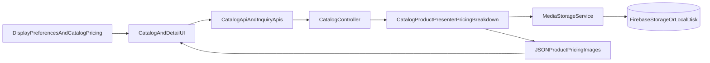

# Stitch White Theme Overhaul Plan (Customer + Artisan Flutter)

## Current Frontend ↔ Backend Linkage (What Must Stay Intact)

- Catalog and product detail data come from [backend/app/Http/Controllers/Api/V1/CatalogController.php](backend/app/Http/Controllers/Api/V1/CatalogController.php), shaped by [backend/app/Services/CatalogProductPresenter.php](backend/app/Services/CatalogProductPresenter.php), and consumed in [frontend/lib/features/catalog/data/catalog_api.dart](frontend/lib/features/catalog/data/catalog_api.dart) and [frontend/lib/features/catalog/models/catalog_product.dart](frontend/lib/features/catalog/models/catalog_product.dart).
- Currency/weight display toggles are frontend-global state in [frontend/lib/core/providers/display_preferences_provider.dart](frontend/lib/core/providers/display_preferences_provider.dart), surfaced by [frontend/lib/features/catalog/ui/catalog_toggle_bar.dart](frontend/lib/features/catalog/ui/catalog_toggle_bar.dart), and rendered via [frontend/lib/core/ui/widgets/price_tag.dart](frontend/lib/core/ui/widgets/price_tag.dart) + [frontend/lib/core/ui/widgets/weight_badge.dart](frontend/lib/core/ui/widgets/weight_badge.dart).
- Price math originates on backend: `metal_value_mmk`, `labor_fee_mmk`, `gem_price_mmk`, `line_total_mmk`, `line_total_usd` are produced in `pricingBreakdown()` from [backend/app/Services/CatalogProductPresenter.php](backend/app/Services/CatalogProductPresenter.php), while FX snapshots are served via [backend/app/Http/Controllers/Api/V1/PricingController.php](backend/app/Http/Controllers/Api/V1/PricingController.php) and consumed by [frontend/lib/core/providers/catalog_pricing_provider.dart](frontend/lib/core/providers/catalog_pricing_provider.dart).
- Media URLs are resolved backend-side through [backend/app/Services/MediaStorageService.php](backend/app/Services/MediaStorageService.php) (Firebase/local abstraction), then consumed either as direct `images[].url` (catalog/detail) or as `storage_path` transformed by [frontend/lib/core/storage/public_storage_url.dart](frontend/lib/core/storage/public_storage_url.dart) in inquiry/order flows.
- Business context from [docs/FYP_Technical_Log.md](docs/FYP_Technical_Log.md), [docs/Demo_Script_Checklist.md](docs/Demo_Script_Checklist.md), and [.cursorrules](.cursorrules): luxury trust-centric journey requires transparent pricing breakdown, unit flexibility (MMK/USD, g/K/P/Y), and uninterrupted concierge workflow.

## Guardrails For The Overhaul

- Do not change API contracts for product/pricing/image payload keys currently used by Flutter.
- Do not remove or bypass `PriceTag`, `WeightBadge`, `DisplayPreferences`, or `CatalogPricing` logic.
- Keep pricing breakdown visible on product detail (only visual redesign; behavior preserved).
- Keep both media patterns working: direct image URL and `storage_path` → `publicStorageUrl()`.
- Keep inquiry/order/chat flow semantics and backend endpoints untouched.

## Step-by-Step Implementation Plan (Phased Safe Rollout)

## Phase 1: Theme Foundation (No Logic Changes)
- Introduce a Stitch-white luxury theme token layer in design system (`AppColors`, text styles, spacing, elevations, controls) while preserving existing component APIs.
- Add light-surface variants for reusable primitives used in customer/artisan screens (cards, chips, buttons, segmented toggles, app bars).
- Keep dark theme references backward-compatible until migration is complete.

## Phase 2: Logic-Preserving Shared Component Restyle
- Restyle `PriceTag` and `WeightBadge` presentation only; keep all conversion/fallback and formatting logic intact.
- Restyle `CatalogToggleBar` to match Stitch visual spec while preserving enum/state wiring and interaction behavior.
- Add subtle transition animations around toggle-driven display changes to preserve premium feel without changing data flow.

## Phase 3: Catalog + Product Detail (Attached Screen Parity)
- Rebuild [frontend/lib/features/catalog/ui/product_catalog_screen.dart](frontend/lib/features/catalog/ui/product_catalog_screen.dart) with white-background card/grid language and typography hierarchy matching attached references.
- Rebuild [frontend/lib/features/catalog/ui/product_detail_screen.dart](frontend/lib/features/catalog/ui/product_detail_screen.dart) layout to Stitch style (hero image, info blocks, icon chips, CTA) while keeping:
  - existing product fetch flow,
  - current pricing breakdown section,
  - inquiry CTA/action semantics.
- Preserve existing `CachedNetworkImage` and product image selection behavior.

## Phase 4: Customer + Artisan Inquiry/Order Surface Migration
- Apply same tokenized white style to customer and artisan inquiry/chat/order screens incrementally, preserving message models, quote/payment cards, and realtime update behavior.
- Keep all API and Firebase chat token flows unchanged.
- Validate attachments/media previews still support both absolute URLs and storage-path derived URLs.

## Phase 5: Cross-Flow QA And Contract Verification
- UI regression checklist:
  - MMK/USD toggle correctness on catalog and detail.
  - g/K/P/Y toggle correctness and formatting.
  - Pricing breakdown visibility and values unchanged.
  - Image rendering for catalog/detail and inquiry/order attachments.
- Data contract checks against backend payloads from catalog/pricing/inquiry/order endpoints.
- Run Flutter analyzer/tests and targeted manual device checks for both customer and artisan journeys.

## Phase 6: Documentation And Handover
- Log architectural and UI migration decisions in [docs/FYP_Technical_Log.md](docs/FYP_Technical_Log.md).
- Document component-level migration map (old style -> Stitch white variant) and remaining optional enhancements.

## Primary Files To Touch First

- [frontend/lib/core/providers/display_preferences_provider.dart](frontend/lib/core/providers/display_preferences_provider.dart)
- [frontend/lib/core/providers/catalog_pricing_provider.dart](frontend/lib/core/providers/catalog_pricing_provider.dart)
- [frontend/lib/core/ui/widgets/price_tag.dart](frontend/lib/core/ui/widgets/price_tag.dart)
- [frontend/lib/core/ui/widgets/weight_badge.dart](frontend/lib/core/ui/widgets/weight_badge.dart)
- [frontend/lib/features/catalog/ui/catalog_toggle_bar.dart](frontend/lib/features/catalog/ui/catalog_toggle_bar.dart)
- [frontend/lib/features/catalog/ui/product_catalog_screen.dart](frontend/lib/features/catalog/ui/product_catalog_screen.dart)
- [frontend/lib/features/catalog/ui/product_detail_screen.dart](frontend/lib/features/catalog/ui/product_detail_screen.dart)
- Design system/theme files under `frontend/lib/core/design_system/` (token and component variants only)