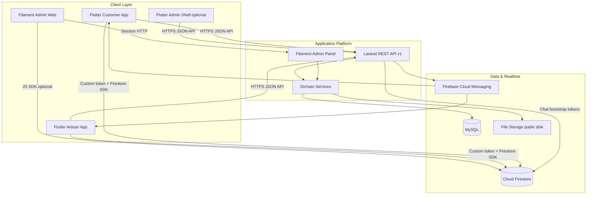
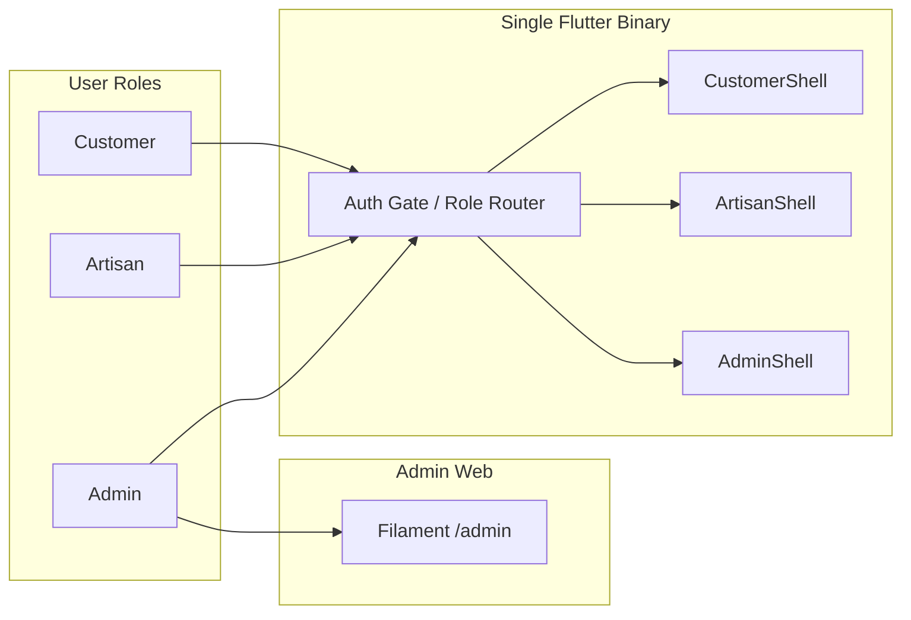
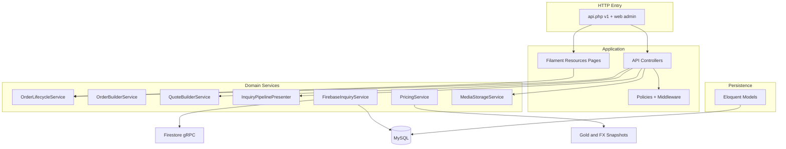
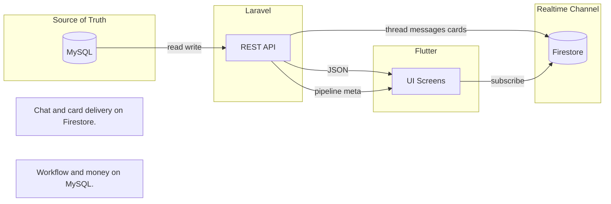
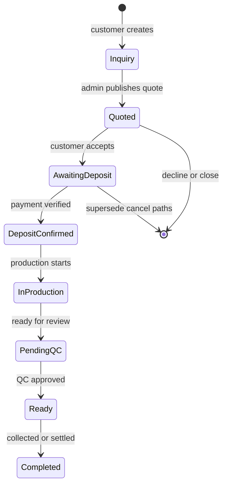
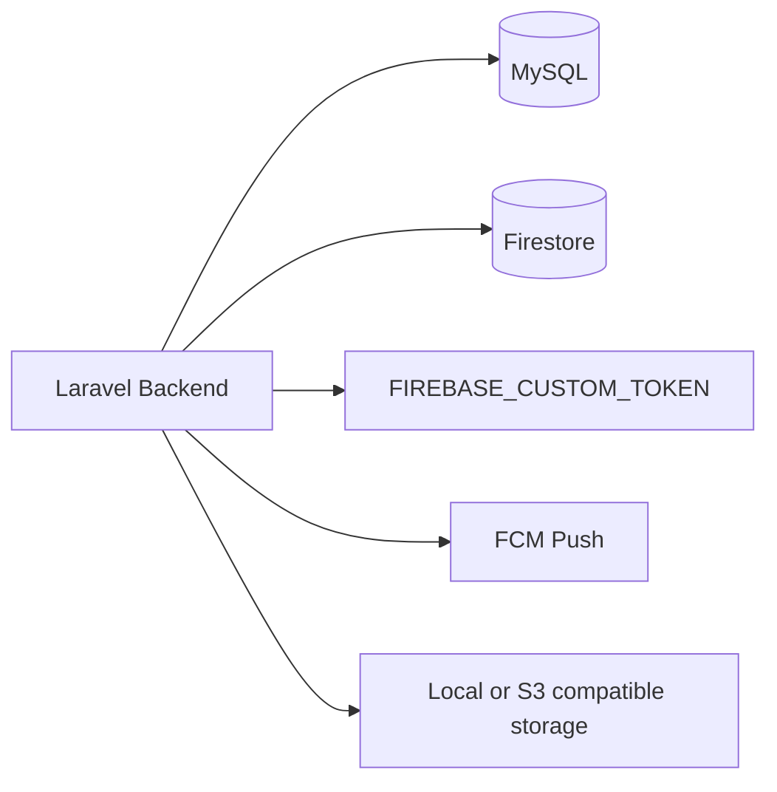

# Shwe Eain Jewelry Hub — System Architecture

This document describes the high-level architecture of the Jewelry Hub platform: mobile clients (Flutter), admin web (Filament), REST API (Laravel), persistence (MySQL), real-time delivery (Firebase), and media storage.

---

## 1. High-level system context

---

## 2. Logical architecture (roles and surfaces)

---

## 3. Backend layers (Laravel)

---

## 4. Data flow: business truth vs real-time delivery

MySQL holds formal state: inquiries, quotes, orders, payments, assignments, receipts, and pricing snapshots. Firestore delivers real-time chat, server-written cards, and thread metadata; the app can fall back to REST pipeline data when Firestore lags.

---

## 5. Order and quote lifecycle (bespoke)

Business rules are enforced in Laravel services (`OrderBuilderService`, `OrderLifecycleService`); statuses in MySQL are authoritative.

---

## 6. External integrations

---

## 7. Technology summary

| Layer | Technology |
|-------|------------|
| Customer & Artisan mobile | Flutter (Dart), Provider, Firebase SDK |
| Admin operations | Filament v3 on Laravel |
| API | Laravel REST ` /api/v1`, Sanctum bearer tokens |
| Database | MySQL |
| Real-time chat | Firebase Firestore |
| Push | Firebase Cloud Messaging |
| Pricing | MMK base; Gold + FX snapshots |

---

## Document maintenance

Update this diagram when adding new integrations (e.g., payment gateways, CDN), splitting apps, or changing the source-of-truth boundary between MySQL and Firestore.
